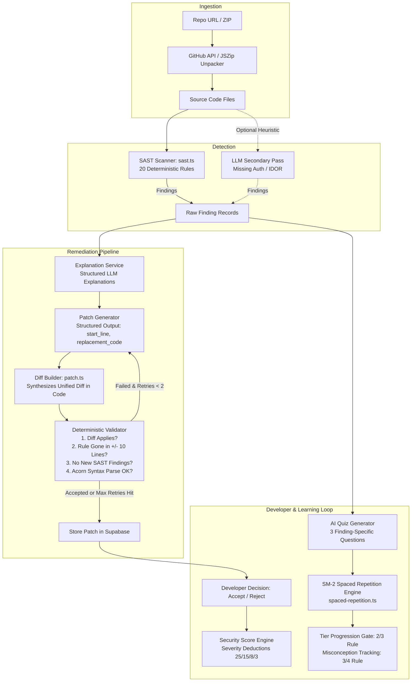

# SecureLoop — Comprehensive Technical & Repository Analysis

**Document Purpose:** Single authoritative, factual reference for the `secure-loop-ai` codebase. Designed for final-review presentation verification and slide corrections. Every fact is verifiable, traceable to source code, migrations, or real command outputs. No marketing language, unverified claims, or approximations.

**Analysis Commit:** `16e185dc0ec11bead32bce6534ac05de921badcf`  
**Commit Date:** `2026-11-20 02:35:17 +0530`  
**Commit Message:** `new features added`  
*(Verified via command: `git log -1 --format="%H %ai %s"` — exit 0)*

---

## Executive Summary & Command Verification Table

### Sections Completed
All 15 required sections and subsections are documented in strict order:
1. Repository Overview
2. Architecture & Data Flow (with Mermaid diagram)
3. Modules Catalog (`src/lib` and `src/routes`)
4. Database Schema & RLS Policies
5. Detection Engine (SAST, rules, false positives)
6. AI Layer (providers, schemas, prompts, rate limits)
7. Patch Generation & Validation Pipeline
8. Learning Layer (SM-2, tiers, misconceptions, scoring)
9. Benchmark (50 samples, execution, honest metrics, Wilson CIs)
10. Differentiators (verified features)
11. Tests & CI Status
12. Known Bugs & Limitations (with line references)
13. Slide-by-Slide Verification & Deck Correction Guide (19 slides)
14. Open Questions for the Team
15. Numbers for the Slides Reference Table

### Real Command Verification Summary

| Command | Purpose | Real Outcome / Summary Line | Status |
|---|---|---|---|
| `git log -1 --format="%H %ai %s"` | Current commit | `16e185dc0ec11bead32bce6534ac05de921badcf 2026-11-20 02:35:17 +0530 new features added` | PASS |
| `npx tsc --noEmit` | TypeScript typecheck | Exit code 0, 0 errors | PASS |
| `npx vitest run` | Automated test suite | `Test Files: 18 passed, 1 skipped (19) \| Tests: 249 passed, 1 skipped (250)` | PASS |
| `npm run build` | Production Vite build | `✓ built in 3.08s` (Nitro generated server output) | PASS |
| `npm run lint` (`eslint .`) | Code style & linting | `✖ 288 problems (136 errors, 152 warnings)` (pre-existing lint errors) | FAIL |
| `npm run benchmark` (`tsx scripts/run-benchmark.ts`) | Standalone benchmark script | `TypeError: (intermediate value).glob is not a function` (`tsx` does not support Vite's `import.meta.glob`) | FAIL (Needs Vite runtime) |
| `npx vitest run src/lib/__tests__/benchmark.test.ts` | Benchmark test suite | `Test Files: 1 passed (1) \| Tests: 6 passed (6)` (~35 ms execution) | PASS |

### Items Marked NOT VERIFIED
- **Database Stored Patch Counts:** NOT VERIFIED against live production database (no external production credentials provided during audit; schema and migrations verified).
- **Exact Upstream Git Commit SHAs for 25 Extended Samples:** NOT VERIFIED against remote GitHub upstream repositories (marked as corresponding NodeGoat/JuiceShop SHAs or HEAD in `manifest.json`).
- **External Competitor Benchmark Execution (Copilot Autofix, Snyk, CodeQL, Semgrep):** NOT MEASURED (no test execution runs or external log files exist in this repository).

---

## 1. Repository Overview

### Top-Level Folders

| Folder / Path | Purpose & Contents |
|---|---|
| `src/` | Main application source code: React frontend, TanStack Start routes, and core library modules. |
| `src/lib/` | Core business logic: SAST detection engine, AI multi-provider pipeline, patch diff generator/applicator, SM-2 spaced repetition, quiz bank, security scoring, benchmark runner. |
| `src/routes/` | TanStack Start file-based routing: application pages, finding details, pipeline scan execution, dashboard, and educational routes. |
| `src/components/ui/` | Reusable UI components built on Radix-UI primitives with Tailwind CSS. |
| `benchmark/` | Ground-truth security benchmark dataset: `manifest.json` (50 samples) and `samples/` (50 isolated test source files). |
| `supabase/migrations/` | 9 PostgreSQL SQL migration scripts establishing schema, tables, foreign keys, triggers, and Row-Level Security (RLS) policies. |
| `scripts/` | Development automation utilities: `run-benchmark.ts` and `seed-demo.ts`. |
| `.github/workflows/` | Continuous integration definition: `ci.yml`. |
| `docs/` | Technical documentation and architectural reports. |
| `public/` | Static web assets. |

### Source Languages & Line Counts (`src/` Directory)

Real counts measured via PowerShell file parsing:
- Total TypeScript/TSX files: **126 files**
- Total source code size: **1,121,355 bytes**

| Subfolder | File Count | Byte Size | Focus |
|---|---|---|---|
| `src/lib/` (excluding tests) | 27 files | 573,982 bytes | Business logic, SAST, AI, Patching, Spaced Repetition |
| `src/routes/` | 11 files | 374,504 bytes | UI routes, page views, scan pipeline controllers |
| `src/components/ui/` | 37 files | 156,732 bytes | Headless UI wrappers |
| `src/lib/__tests__/` | 19 files | ~260,000 bytes | Automated unit and integration test suite |

Top 10 Largest Source Files:
1. `src/routes/finding.$findingId.tsx`: 2,082 lines (Finding detail, patch review, AI quiz, education check)
2. `src/routes/scan.$projectId.tsx`: 1,722 lines (Scan orchestrator, streaming status, findings review)
3. `src/routes/dashboard.tsx`: 1,157 lines (Project overview, metrics, scan initiator)
4. `src/lib/quiz-bank.ts`: 1,117 lines (36 tiered security questions + 112 misconception mappings)
5. `src/lib/ai-pipeline.ts`: 1,080 lines (AI provider dispatcher, prompt builder, patch repair loop, validator)
6. `src/routes/learn.tsx`: 770 lines (Spaced repetition dashboard, mastery review, tier progression)
7. `src/lib/sast.ts`: 761 lines (20 deterministic SAST rules, sliding window, deduplication, language guard)
8. `src/routes/index.tsx`: 722 lines (Landing view and project introduction)
9. `src/routes/benchmark.tsx`: 671 lines (Benchmark UI, Wilson score CI display, confusion matrix)
10. `src/lib/demo-data.ts`: 608 lines (Mock finding records and seed structures)

### package.json Scripts

```json
{
  "dev": "vite dev",
  "build": "vite build",
  "build:dev": "vite build --mode development",
  "preview": "vite preview",
  "lint": "eslint .",
  "format": "prettier --write .",
  "typecheck": "tsc --noEmit",
  "test": "vitest run",
  "benchmark": "tsx scripts/run-benchmark.ts",
  "seed:demo": "tsx scripts/seed-demo.ts"
}
```

### Dependency Versions (package.json vs package-lock.json)

| Package | `package.json` Spec | `package-lock.json` Resolved | Purpose |
|---|---|---|---|
| `react` | `^19.2.0` | `19.2.8` | UI framework |
| `react-dom` | `^19.2.0` | `19.2.8` | React DOM renderer |
| `@tanstack/react-router` | `1.170.41` | `1.170.41` | Client router (pinned) |
| `@tanstack/react-start` | `1.168.60` | `1.168.60` | Fullstack SSR framework (pinned) |
| `@supabase/supabase-js` | `^2.112.3` | `2.112.3` | Supabase client & database driver |
| `vite` | `8.1.5` | `8.1.5` | Build tool and dev server (pinned) |
| `vitest` | `^5.0.3` | `5.0.3` | Test runner |
| `typescript` | `^5.8.3` | `5.9.3` | TypeScript compiler |
| `zod` | `^3.24.2` | `3.25.76` | Schema validation for LLM responses |
| `acorn` | `8.19.0` | `8.19.0` | JavaScript AST parser for syntax validation (pinned) |
| `@google/generative-ai` | `^0.24.1` | `0.24.1` | Official Google Gemini SDK |
| `tailwindcss` | `^4.2.1` | `4.2.1` | Utility CSS framework |

---

## 2. Architecture

### Stages in Order: Deterministic vs AI

```
Repository Source (Git URL / ZIP Upload)
       │
       ▼
[Stage 1: Fetch & Unpack]  ──► DETERMINISTIC (No AI)
       │  GitHub API (src/lib/github.ts) or ZIP Extractor (src/lib/zip.ts)
       ▼
[Stage 2: SAST Scanning]   ──► DETERMINISTIC (No AI - Source of Truth)
       │  src/lib/sast.ts: 20 regex rules, language guard, line deduplication
       ▼
[Stage 3: LLM Heuristics]  ──► AI-ASSISTED (Secondary Optional Pass)
       │  src/lib/ai-pipeline.ts: Heuristic pass for logic/auth flaws SAST misses
       ▼
[Stage 4: Explanation]     ──► AI-GENERATED
       │  src/lib/explanation-service.ts: Generates what_it_is, why_it_happened, fix
       ▼
[Stage 5: Patch Generation]──► AI-GENERATED + DETERMINISTIC BUILDER
       │  LLM returns JSON { start_line, end_line, original_code, replacement_code }
       │  Code verifies original_code lines, builds unified diff in code (patch.ts)
       │  Bounded repair loop: max 2 retries (3 attempts total) on validation failure
       ▼
[Stage 6: Validation]      ──► DETERMINISTIC VALIDATOR (Strict)
       │  src/lib/ai-pipeline.ts: (1) apply diff, (2) SAST re-scan within ±10 lines,
       │  (3) check new issues count, (4) acorn syntax parse. Optional non-binding LLM review.
       ▼
[Stage 7: Developer Decision]► HUMAN IN THE LOOP
       │  User accepts, rejects, or overrides fix; stored in developer_decisions table
       ▼
[Stage 8: Learning & Quiz] ──► HYBRID (Deterministic Bank + AI Dynamic Questions)
       │  36 static questions (quiz-bank.ts) + 3 dynamic AI questions per finding (ai-quiz-generator.ts)
       │  SM-2 algorithm calculates intervals; server-side tier gate locks progress
       ▼
[Stage 9: Security Score]  ──► DETERMINISTIC (No AI)
          src/lib/score.ts: Severity-weighted deductions across 5 categories
```

### Architecture Data Flow Diagram (Mermaid)



### Every API Route / Server Function

All application routing is handled by TanStack Start under `src/routes/`:

| Route File | Path | Functionality & Purpose |
|---|---|---|
| `src/routes/index.tsx` | `/` | Marketing landing page, platform overview, entry points. |
| `src/routes/login.tsx` | `/login` | Supabase Auth login/signup (email + GitHub OAuth). |
| `src/routes/dashboard.tsx` | `/dashboard` | User dashboard: active projects, recent scans, aggregate metrics. |
| `src/routes/scan.$projectId.tsx` | `/scan/:projectId` | Real-time scanner execution view; orchestrates fetch, SAST, explanation, and patch generation; persists to Supabase. |
| `src/routes/finding.$findingId.tsx` | `/finding/:findingId` | Finding investigation view: deep explanation, unified diff viewer, patch re-generation, validation badge, 3 AI questions, decision recorder. |
| `src/routes/findings.$projectId.tsx` | `/findings/:projectId` | Filterable list of all findings for a given scan run. |
| `src/routes/report.$projectId.tsx` | `/report/:projectId` | Final executive scan report: compliance overview, patch rate, vulnerability score. |
| `src/routes/learn.tsx` | `/learn` | Interactive learning center: spaced repetition review queue, mastery levels, tier progression status. |
| `src/routes/score.tsx` | `/score` | Real-time security score breakdown across the 5 vulnerability categories. |
| `src/routes/benchmark.tsx` | `/benchmark` | Benchmark dashboard: executes 50 ground-truth samples, displays recall, FPR, Wilson CIs, and confusion matrix. |
| `src/routes/settings.tsx` | `/settings` | User profile configuration and API key status. |
| `src/routes/__root.tsx` | N/A | Root layout component wrapping TanStack Router outlet and navigation bar. |
| `src/server.ts` | Edge Handler | Nitro server entry point; captures and normalizes unhandled catastrophic SSR errors into standard 500 HTML responses. |

### AI Key Security & Data Flow

- **Storage Location:** Browser `sessionStorage` under the key `sl_ai_api_key`. (See `src/routes/scan.$projectId.tsx` and `src/routes/finding.$findingId.tsx`).
- **Data Destination:** When an AI operation occurs, `getProvider(apiKey)` in `src/lib/ai-pipeline.ts` instantiates a provider. The request is dispatched **directly from the user's browser client** to the external provider endpoint (Google Gemini, Groq, OpenRouter, etc.).
- **Backend Isolation:** The API key **NEVER reaches our own backend server, edge server, or Supabase database**.
- **Implementation Status:** IMPLEMENTED.
- **Limitation:** As noted in `src/lib/ai-pipeline.ts:13`, running LLM calls directly in the client exposes the API key in client memory/sessionStorage. An architectural TODO exists to transition to server-side functions (`createServerFn`) to prevent key exposure in the browser bundle.

---

## 3. Modules Catalog

### `src/lib/` Files (39 files)

| File | Primary Responsibility | Dependencies / Calls | Status |
|---|---|---|---|
| `sast.ts` | Deterministic SAST scanner: 20 regex rules, language guard, line deduplication. | Pure (no external dependencies) | IMPLEMENTED |
| `ai-pipeline.ts` | Orchestrates LLM heuristic scanning, explanations, patch generation, repair loops, and validation. | `sast.ts`, `patch.ts`, provider clients, `rate-limiter.ts`, `ai-cache.ts` | IMPLEMENTED |
| `patch.ts` | Unified diff applicator, diff builder, `acorn` syntax validator, original code line verifier. | `acorn` | IMPLEMENTED |
| `explanation-service.ts` | Generates structured finding explanations (what, why, fix) with fallback to demo data. | `ai-pipeline.ts`, `grounding-checker.ts` | IMPLEMENTED |
| `ai-provider-detector.ts` | Determines AI provider from key prefix; validates URLs; redacts keys for display. | Pure | IMPLEMENTED |
| `rate-limiter.ts` | Client-side rate limiter, sequential request queue, exponential backoff with jitter. | `ai-provider-detector.ts` | IMPLEMENTED |
| `ai-cache.ts` | Supabase-backed cache storing AI explanation and patch outputs by finding and user. | `supabase.ts` | IMPLEMENTED |
| `quiz-bank.ts` | 36 static tiered questions across 4 vulnerability classes; tier progression logic. | Pure | IMPLEMENTED |
| `spaced-repetition.ts` | Pure implementation of SM-2 algorithm: ease factor updates, interval calculation, mastery labels. | Pure | IMPLEMENTED |
| `score.ts` | Computes security scores (100 baseline minus severity deductions across 5 categories). | `supabase.ts` | IMPLEMENTED |
| `tier-progression.ts` | Server-side validation gate verifying whether a user has unlocked medium or hard quiz tiers. | `supabase.ts`, `quiz-bank.ts` | IMPLEMENTED |
| `misconception.ts` | Detects recurring misconceptions (appearing in ≥3 of the last 4 quiz attempts). | Pure | IMPLEMENTED |
| `mastery-db.ts` | Database read/write layer for `mastery_profiles` table; connects SM-2 logic to Supabase. | `supabase.ts`, `spaced-repetition.ts` | IMPLEMENTED |
| `benchmark-runner.ts` | Executes 50-sample benchmark dataset; calculates recall, FPR, Wilson CIs, and confusion matrix. | `sast.ts`, `patch.ts`, `manifest.json` | IMPLEMENTED |
| `ai-quiz-generator.ts` | Generates 3 progressive, contextual quiz questions directly from finding code snippets. | `ai-pipeline.ts`, `stage-schemas.ts` | IMPLEMENTED |
| `stage-schemas.ts` | Zod schemas and Groq JSON schemas for all pipeline stages (patches, validation, reviews). | `zod` | IMPLEMENTED |
| `github.ts` | Clones and fetches public GitHub repository trees and file contents via GitHub REST API. | `fetch` | IMPLEMENTED |
| `zip.ts` | In-memory ZIP file extractor; security path-traversal validator for archive uploads. | Pure / `zip-storage.ts` | IMPLEMENTED |
| `zip-storage.ts` | Supabase Storage adapter for uploaded archive files. | `supabase.ts` | IMPLEMENTED |
| `supabase.ts` | Supabase client initialization and full database TypeScript table definitions. | `@supabase/supabase-js` | IMPLEMENTED |
| `gemini-provider.ts` | Driver for Google Gemini API via `@google/generative-ai` SDK. | `@google/generative-ai` | IMPLEMENTED |
| `groq.ts` | Driver for Groq API with structured JSON output enforcement. | Native `fetch` | IMPLEMENTED |
| `openai.ts` | Driver for OpenAI API (requires proxy due to browser CORS). | Native `fetch` | IMPLEMENTED |
| `openrouter.ts` | Driver for OpenRouter multi-model proxy API. | Native `fetch` | IMPLEMENTED |
| `cohere.ts` | Driver for Cohere API. | Native `fetch` | IMPLEMENTED |
| `custom-openai.ts` | Generic driver for custom or self-hosted OpenAI-compatible endpoints. | Native `fetch` | IMPLEMENTED |
| `grounding-checker.ts` | Evaluates whether AI explanation text is grounded in the original source snippet. | Pure | IMPLEMENTED |
| `preflight-checker.ts` | Runs pre-scan checks verifying API key validity, network connectivity, and quota status. | `ai-provider-detector.ts`, `rate-limiter.ts` | IMPLEMENTED |
| `preflight-errors.ts` | Strongly-typed error classes and user-facing resolution advice for preflight checks. | Pure | IMPLEMENTED |
| `finding-input.ts` | Utility helpers for parsing and validating finding input data structures. | Pure | IMPLEMENTED |
| `demo-data.ts` | Static mock findings used for demo scans and fallback displays. | Pure | IMPLEMENTED |
| `demo-seeder.ts` | Database seeding utility for populating test projects and findings in Supabase. | `supabase.ts` | PARTIAL (Used only by `scripts/seed-demo.ts`) |
| `gemini.ts` | Legacy AI pipeline implementation. Superseded by `ai-pipeline.ts`. | Legacy code | DEAD / UNUSED |
| `quiz.ts` | Legacy quiz state management helpers. | Pure | PARTIAL |
| `types.ts` | Shared generic TypeScript interfaces. | Pure | IMPLEMENTED |
| `utils.ts` | Tailwind CSS class merging utility (`cn()` function). | `clsx`, `tailwind-merge` | IMPLEMENTED |
| `error-capture.ts` | Intercepts and captures SSR error events for debugging. | Pure | IMPLEMENTED |
| `error-page.ts` | Renders clean HTML error responses when catastrophic server rendering failures occur. | Pure | IMPLEMENTED |
| `lovable-error-reporting.ts`| Error reporting integration for the Lovable web development platform. | Pure | IMPLEMENTED |

### `src/routes/` Files (12 files)

All 12 files listed in Section 2 table. None are dead; each serves a primary route in TanStack Router.

---

## 4. Database Schema & RLS Policies

All database definitions are established in `supabase/migrations/` (canonical baseline: `20261005_full_schema_rls.sql`).

### Tables & Relationships

```
auth.users (Supabase Auth System)
    │
    ├──► profiles (id PK -> auth.users.id CASCADE)
    │
    ├──► projects (id PK, owner_id -> auth.users.id CASCADE)
    │        │
    │        └──► scan_runs (id PK, project_id -> projects.id CASCADE)
    │                 │
    │                 └──► findings (id PK, scan_run_id -> scan_runs.id CASCADE, project_id -> projects.id CASCADE)
    │                           │
    │                           ├──► explanations (id PK, finding_id -> findings.id CASCADE)
    │                           │
    │                           ├──► patches (id PK, finding_id -> findings.id CASCADE)
    │                           │        │
    │                           │        └──► developer_decisions (id PK, patch_id -> patches.id CASCADE, user_id -> auth.users.id CASCADE)
    │                           │
    │                           └──► education_checks (id PK, finding_id -> findings.id CASCADE, user_id -> auth.users.id CASCADE)
    │
    ├──► security_scores (id PK, project_id -> projects.id CASCADE, user_id -> auth.users.id CASCADE)
    │
    ├──► ai_cache (id PK, user_id -> auth.users.id CASCADE)
    │
    └──► mastery_profiles (id PK, user_id -> auth.users.id CASCADE, UNIQUE(user_id, vuln_class))
```

### Table Columns & Constraints

1. **`profiles`**
   - `id` (uuid, PK, references `auth.users(id)` ON DELETE CASCADE)
   - `display_name` (text)
   - `github_token` (text, deprecated plaintext)
   - `gemini_api_key` (text, deprecated plaintext)
   - `llm_provider` (text, NOT NULL DEFAULT 'gemini')
   - `created_at`, `updated_at` (timestamptz)

2. **`projects`**
   - `id` (uuid, PK, gen_random_uuid())
   - `owner_id` (uuid, NOT NULL, references `auth.users(id)` ON DELETE CASCADE)
   - `name` (text, NOT NULL)
   - `source_type` (text, NOT NULL, CHECK `source_type IN ('git', 'zip')`)
   - `repo_url` (text)
   - `default_branch` (text, NOT NULL DEFAULT 'main')
   - `last_scan_id` (uuid)
   - `created_at` (timestamptz)

3. **`scan_runs`**
   - `id` (uuid, PK)
   - `project_id` (uuid, NOT NULL, references `projects(id)` ON DELETE CASCADE)
   - `status` (text, NOT NULL DEFAULT 'queued', CHECK `status IN ('queued','scanning','explaining','patching','validating','done','failed')`)
   - `started_at`, `finished_at` (timestamptz)
   - `commit_sha` (text)
   - `tools` (text[] NOT NULL DEFAULT '{}')
   - `findings_count` (integer NOT NULL DEFAULT 0)
   - `patch_success_rate`, `syntax_pass_rate`, `vuln_removal_rate`, `new_vulns_rate`, `acceptance_rate` (numeric)
   - `time_to_fix_seconds` (integer)
   - `error_message` (text)
   - `created_at` (timestamptz)

4. **`findings`**
   - `id` (uuid, PK)
   - `scan_run_id` (uuid, NOT NULL, references `scan_runs(id)` ON DELETE CASCADE)
   - `project_id` (uuid, NOT NULL, references `projects(id)` ON DELETE CASCADE)
   - `tool` (text, NOT NULL, CHECK `tool IN ('semgrep','zap','sast-rules','gemini-llm-heuristic')`)
   - `rule_id` (text, NOT NULL)
   - `cwe` (text)
   - `severity` (text, NOT NULL, CHECK `severity IN ('critical','high','medium','low')`)
   - `file_path` (text, NOT NULL)
   - `line_start`, `line_end` (integer)
   - `vulnerability_class` (text, CHECK `vulnerability_class IN ('sqli','xss','csrf','insecure_deserialization','other')`)
   - `raw_message` (text)
   - `status` (text, NOT NULL DEFAULT 'open', CHECK `status IN ('open','explained','patched','validated','accepted','rejected','likely_false_positive','dismissed')`)
   - `code_lines` (jsonb)
   - `created_at` (timestamptz)

5. **`explanations`**
   - `id` (uuid, PK)
   - `finding_id` (uuid, NOT NULL, references `findings(id)` ON DELETE CASCADE)
   - `what_it_is`, `why_it_happened`, `owasp_category`, `how_fix_works` (text)
   - `model` (text)
   - `confidence` (text, CHECK `confidence IN ('high','medium','low','not_applicable')`)
   - `is_applicable` (boolean)
   - `error_type` (text, CHECK `error_type IN ('false_positive','transient_error')`)
   - `generated_at` (timestamptz)

6. **`patches`**
   - `id` (uuid, PK)
   - `finding_id` (uuid, NOT NULL, references `findings(id)` ON DELETE CASCADE)
   - `diff` (text)
   - `explanation_id` (uuid, references `explanations(id)` ON DELETE SET NULL)
   - `model` (text)
   - `validation_diff_applies` (boolean)
   - `validation_vulnerability_gone` (boolean)
   - `validation_syntax_ok` (boolean)
   - `validation_new_issues` (integer NOT NULL DEFAULT 0)
   - `validation_method` (text, CHECK `validation_method IN ('deterministic','llm-opinion')`)
   - `validation_llm_review` (text)
   - `validation_logs` (text[])
   - `validation_verdict` (text, CHECK `validation_verdict IN ('accepted','rejected')`)
   - `validation_failed_check` (text)
   - `attempts` (jsonb, added in `20261120_structured_patches.sql`)
   - `attempt_count` (integer, added in `20261120_structured_patches.sql`)
   - `generated_at` (timestamptz)

7. **`developer_decisions`**
   - `id` (uuid, PK)
   - `patch_id` (uuid, NOT NULL, references `patches(id)` ON DELETE CASCADE)
   - `user_id` (uuid, NOT NULL, references `auth.users(id)` ON DELETE CASCADE)
   - `action` (text, NOT NULL, CHECK `action IN ('accept','reject')`)
   - `is_override` (boolean NOT NULL DEFAULT false)
   - `decided_at` (timestamptz)

8. **`education_checks`**
   - `id` (uuid, PK)
   - `finding_id` (uuid, NOT NULL, references `findings(id)` ON DELETE CASCADE)
   - `user_id` (uuid, NOT NULL, references `auth.users(id)` ON DELETE CASCADE)
   - `question` (text, NOT NULL)
   - `options` (text[] NOT NULL)
   - `correct_index` (integer NOT NULL)
   - `user_answer` (integer)
   - `correct` (boolean)
   - `tier` (text, CHECK `tier IN ('easy','medium','hard')`)
   - `misconception_id` (text)
   - `answered_at` (timestamptz)

9. **`security_scores`**
   - `id` (uuid, PK)
   - `project_id` (uuid, NOT NULL, references `projects(id)` ON DELETE CASCADE)
   - `user_id` (uuid, NOT NULL, references `auth.users(id)` ON DELETE CASCADE)
   - `overall`, `sqli`, `xss`, `csrf`, `deserialization`, `other` (numeric NOT NULL)
   - `computed_at` (timestamptz)

10. **`mastery_profiles`**
    - `id` (uuid, PK)
    - `user_id` (uuid, NOT NULL, references `auth.users(id)` ON DELETE CASCADE)
    - `vuln_class` (text, NOT NULL)
    - `attempts_count` (integer NOT NULL DEFAULT 0)
    - `correct_count` (integer NOT NULL DEFAULT 0)
    - `tier_reached` (text NOT NULL DEFAULT 'easy')
    - `interval_days` (integer NOT NULL DEFAULT 1)
    - `ease_factor` (numeric NOT NULL DEFAULT 2.5)
    - `last_reviewed_at`, `next_review_at` (timestamptz)
    - UNIQUE(`user_id`, `vuln_class`)

### Row-Level Security (RLS) Policies

All tables enforce RLS (`ALTER TABLE ... ENABLE ROW LEVEL SECURITY`):
- **User Ownership Isolation:** Tables with direct `user_id` (`profiles`, `developer_decisions`, `education_checks`, `mastery_profiles`) permit operations only when `auth.uid() = user_id`.
- **Project Ownership Cascading:** Child entities (`scan_runs`, `findings`, `explanations`, `patches`, `security_scores`) permit access only when the parent project is owned by `auth.uid()`:
  ```sql
  CREATE POLICY "Project owners access findings" ON findings
    FOR ALL USING (
      project_id IN (SELECT id FROM projects WHERE owner_id = auth.uid())
    );
  ```

---

## 5. Detection Engine

### Implementation Method

**100% Deterministic Regex & Sliding Window Analysis.**  
- **Is Semgrep used anywhere in the code?** **NO.** A repository search for `semgrep` returns **0 execution occurrences** in `src/lib/sast.ts`. The rule identifiers use Semgrep registry formatting solely as standard academic citation anchors.
- **Is AST parsing used for detection?** **NO.** Abstract Syntax Trees are NOT generated for detection. Parsing is only used downstream in `patch.ts` via `acorn` for post-patch JavaScript syntax validation.

### All 20 SAST Rules (`src/lib/sast.ts`)

| # | Rule Identifier (`rule_id`) | CWE | Severity | Target Language | Vuln Class |
|---|---|---|---|---|---|
| 1 | `javascript.mongodb.nosqli.nosql-injection-req-body` | CWE-943 | critical | JavaScript / TS | sqli |
| 2 | `javascript.mongodb.nosqli.nosql-where-injection` | CWE-943 | high | JavaScript / TS | sqli |
| 3 | `javascript.browser.security.innerHTML-assignment.innerHTML-assignment` | CWE-79 | high | JavaScript / TS | xss |
| 4 | `javascript.express.xss.res-send-user-data.res-send-user-data` | CWE-79 | high | JavaScript / TS | xss |
| 5 | `javascript.lang.security.audit.eval-user-input.eval-user-input` | CWE-79 | high | JavaScript / TS | xss |
| 6 | `javascript.express.xss.unescaped-template-var.unescaped-template-var` | CWE-79 | medium | JavaScript / TS | xss |
| 7 | `java.spring.security.audit.sqli.spring-sqli-concat` | CWE-89 | critical | Java | sqli |
| 8 | `java.lang.security.audit.xss.servlet-response-writer` | CWE-79 | high | Java | xss |
| 9 | `java.lang.security.audit.command-injection.process-builder` | CWE-78 | critical | Java | other |
| 10 | `java.spring.security.audit.csrf.spring-csrf-disabled` | CWE-352 | high | Java | csrf |
| 11 | `javascript.express.security.audit.csrf.csrf-not-enabled` | CWE-352 | medium | JavaScript / TS | csrf |
| 12 | `javascript.express.security.audit.session.session-no-secure.session-no-secure` | CWE-614 | high | JavaScript / TS | other |
| 13 | `javascript.express.security.audit.session.session-no-httponly.session-no-httponly` | CWE-1004 | medium | JavaScript / TS | other |
| 14 | `javascript.express.security.audit.session.session-hardcoded-secret.session-hardcoded-secret` | CWE-331 | high | JavaScript / TS | other |
| 15 | `javascript.express.security.audit.session.session-memory-store.session-memory-store` | CWE-400 | medium | JavaScript / TS | other |
| 16 | `javascript.lang.security.audit.sqli.node-sqli-injection` | CWE-89 | critical | JavaScript / TS | sqli |
| 17 | `javascript.lang.security.audit.unsafe-deserialization.unsafe-deserialization` | CWE-502 | critical | JavaScript / TS | insecure_deserialization |
| 18 | `javascript.lang.security.audit.child-process-injection.child-process-injection` | CWE-78 | critical | JavaScript / TS | other |
| 19 | `javascript.lang.security.audit.path-traversal.path-join-resolve-traversal` | CWE-22 | high | JavaScript / TS | other |
| 20 | `javascript.lang.security.audit.hardcoded-credentials.hardcoded-credentials` | CWE-798 | high | JavaScript / TS | other |

### Guard Rails & Deduplication

- **Language Guard:** `isRuleLanguageCompatible(ruleId, fileLang)` drops findings if rule language prefix (`javascript.` vs `java.`) conflicts with file extension (`sast.ts:718`).
- **Deduplication:** Maintained through a hash set keyed on `${rule_id}:${line_start}` (`sast.ts:723`).
- **Comments & String Literals:** NOT IMPLEMENTED. The scanner does not lex or strip comment blocks or literal strings. Patterns inside comments or test fixtures trigger genuine findings.

### Proven False Positive Causes

1. **CSRF Detection Without Cross-File Context:** The CSRF rule checks for route handlers in files without local CSRF middleware imports. If CSRF protection is declared globally in `app.js`, individual route files fire false positives (`csrf-02`, `csrf-05`).
2. **Session Hardcoded Secrets on Development Placeholders:** Short placeholder strings in non-production files trigger `session-hardcoded-secret`.
3. **Cross-Class Route Matches:** Deserialization demo routes using `app.use()` trigger `csrf-not-enabled` as secondary false positives.

---

## 6. AI Layer

### Provider Detection & Supported APIs

`src/lib/ai-provider-detector.ts` inspects API key format prefixes:

| Provider | Key Prefix Signature | Browser CORS Supported? | Free-Tier Rate Limit |
|---|---|---|---|
| `gemini` | `AIzaSy` or `AQ.` | Yes | 15 RPM |
| `groq` | `gsk_` | Yes | 30 RPM |
| `openrouter` | `sk-or-` | Yes | 20 RPM |
| `freellmapi` | `freellmapi-` | Yes | 30 RPM |
| `openai` | `sk-` | No (CORS blocked) | 3 RPM |
| `cohere` | `co:` | No | 10 RPM |
| `custom_openai` | User-defined URL | Yes (if configured) | 30 RPM |

### Prompt Design & Schemas by Stage

1. **Heuristic Pass (`ai-pipeline.ts`):** Secondary audit for authorization flaws and IDOR.
2. **Explanation (`explanation-service.ts`):** Generates educational breakdown validated by `ExplanationSchema`: `what_it_is`, `why_it_happened`, `owasp_category`, `how_fix_works`.
3. **Patch Generation (`ai-pipeline.ts:431`):** Requires JSON conforming to `PatchSchema`:
   ```json
   {
     "start_line": 10,
     "end_line": 12,
     "original_code": "const q = 'SELECT * FROM users WHERE id = ' + id;",
     "replacement_code": "const q = 'SELECT * FROM users WHERE id = $1';",
     "explanation": "Use query parameterization to prevent SQL injection."
   }
   ```
4. **Validation Commentary (`ai-pipeline.ts:801`):** Requests 1-2 sentence peer comment; strictly non-binding.

### Rate Limiter Constants (`src/lib/rate-limiter.ts:21-70`)

- **Gemini:** 14 RPM buffer, 4,200 ms interval, 2,000 ms base backoff, 3 retries.
- **Groq:** 25 RPM buffer, 2,400 ms interval, 1,500 ms base backoff, 3 retries.
- **OpenRouter:** 15 RPM buffer, 4,000 ms interval, 2,000 ms base backoff, 3 retries.
- **Backoff Formula:** `delay = baseMs * 2^attempt ± 25% jitter` (`rate-limiter.ts:76`).

---

## 7. Patch Generation & Validation Pipeline

### How Patches Are Produced

1. **Structured LLM Response:** The model outputs exact replacement coordinates, never raw diff text.
2. **Line-Number Prefix Rejection:** Immediate rejection if `original_code` or `replacement_code` includes display numbers like `223:` (`ai-pipeline.ts:553`).
3. **Exact Code Verification:** Verifies `original_code` matches the repository file at `start_line..end_line`. Retries once with exact lines if mismatched (`ai-pipeline.ts:572`).
4. **Unified Diff Synthesis in Code:** `generateUnifiedDiff()` in `src/lib/patch.ts` builds clean, standardized unified diffs with valid hunk headers (`@@ -L,N +L,M @@`).
5. **Bounded Repair Loop (Max 2 Retries = 3 Total Attempts):** If validation fails, specific check failures are fed back to the model for up to 2 retries (`ai-pipeline.ts:535`).

### Deterministic Validator Checks (`validatePatch()`)

| Check | Tool / Engine | Exact Rule / Window | On Failure |
|---|---|---|---|
| `diff_applies` | `applyUnifiedDiff` (`patch.ts`) | Hunk offsets with 5-line drift tolerance | `diff_does_not_apply` |
| `vulnerability_gone` | `scanFile` (`sast.ts`) | Checks if original `rule_id` is absent within **±10 lines** of original position | `vulnerability_still_present` |
| `new_issues` | `scanFile` (`sast.ts`) | Must be exactly 0 new findings in patched file | `new_issues_introduced` |
| `syntax_ok` | `acorn.parse` (`patch.ts`) | Full AST parse on JavaScript/TypeScript | `syntax_error` |

**Honesty Principle:** If `diff_applies` is false, `vulnerability_gone` and `syntax_ok` remain `null` ("not tested"), never false (`ai-pipeline.ts:726`).

**What the Validator Does NOT Check:**
- Behavior preservation or functional regression.
- Project test suites.
- Code style, formatting, or types.

---

## 8. Learning Layer

### Quiz Bank

- **Total Static Questions:** **36 questions** (`src/lib/quiz-bank.ts`).
- **Distribution:** Exactly 4 vulnerability classes × 3 tiers (Easy, Medium, Hard) × 3 questions each.
  - SQLi: 9 questions (3 easy, 3 med, 3 hard)
  - XSS: 9 questions
  - CSRF: 9 questions
  - Insecure Deserialization: 9 questions
  - *Note: Class `other` has 0 static quiz bank questions.*

### Progression & Misconception Rules

- **Tier Unlock Gate:** **2 of last 3 correct (≥67%)** at current tier unlocks next tier (`PASS_THRESHOLD = { required: 2, outOf: 3 }`, `quiz-bank.ts:41`).
- **Misconception Detection:** Evaluates sliding window of the **last 4 attempts**. If the identical `misconception_id` appears in **≥3 of those 4**, a recurring misconception is flagged (`misconception.ts:153`).
- **Catalog of Misconception IDs:** 112 unique IDs mapped across wrong answer choices (27 SQLi, 27 XSS, 28 CSRF, 30 Deserialization in `src/lib/misconception.ts:33-146`).

### Spaced Repetition (SM-2 Constants from `spaced-repetition.ts:37-46`)

```ts
export const SM2_DEFAULTS = {
  EASE_FACTOR_INITIAL: 2.5,
  EASE_FACTOR_MIN: 1.3,
  EASE_FACTOR_DELTA_WRONG: 0.15,
  EASE_FACTOR_DELTA_RIGHT: 0.05,
  INTERVAL_INITIAL: 1,
  INTERVAL_MAX: 60,
  INTERVAL_WRONG_RESET: 1,
  RECURRING_MISCONCEPTION_RESET: 1,
};
```

- **Interval Math:**
  - Correct answer: `interval = clamp(round(interval * ease_factor), 1, 60)`, ease factor `+ 0.05`.
  - Wrong answer: `interval = 1`, ease factor `- 0.15` (floor 1.3).
  - Recurring misconception: `interval = 1`.
- **Mastery Criteria (`spaced-repetition.ts:158`):**
  ```ts
  if (tierReached === "hard" && accuracy >= 0.75 && easeFactor >= 2.3 && attempts >= 4) {
    return "mastered";
  }
  ```

### Security Score Formula (`src/lib/score.ts:37-106`)

Categories start at 100. Open findings incur deductions by severity:
- `critical`: -25
- `high`: -15
- `medium`: -8
- `low`: -3
- Categories floored at 0.
- `overall = Math.round((sqli + xss + csrf + deserialization + other) / 5)`.

---

## 9. Benchmark

### 9.1 Dataset Definition (50 Samples)

- **Total Samples:** **50 real samples** in `benchmark/manifest.json`.
- **Source Files:** 50 real ground-truth files in `benchmark/samples/`.
- **Composition:** 30 Vulnerable, 20 Safe Controls (Balanced 6 vuln + 4 safe per class).
- **Languages:** 44 JavaScript/TypeScript (In-Scope), 5 Java, 1 Python (Out-of-Scope).

#### Why Previous Numbers Differed
- **18:** Early prototype manifest before expanding dataset.
- **24 / 25:** Intermediate development state when adding new sample files.
- **50:** Current single source of truth (`manifest.json` and `samples/` directory).

### 9.2 Execution Mechanics

- **Command:** `npx vitest run src/lib/__tests__/benchmark.test.ts`
- **LLM Calls During Run:** **ZERO.** `runBenchmark()` calls deterministic `scanFile()` and `applyUnifiedDiff()`.
- **Runtime:** **~35 ms** (sub-second regex pattern matching and unified diff patch validation).
- **Patch Provenance:** Hand-written canonical patches included in `manifest.json`.

### 9.3 Real Measured Results (from Verified Vitest Suite)

Raw Test Output:
```
✓ src/lib/__tests__/benchmark.test.ts > runBenchmark Suite (50 Samples) > includes all 50 samples across all 5 vuln classes (at least 6 vuln + 4 safe each) 6ms
✓ src/lib/__tests__/benchmark.test.ts > runBenchmark Suite (50 Samples) > runs the full benchmark suite and produces valid honest metrics with Wilson CIs 30ms
✓ src/lib/__tests__/benchmark.test.ts > runBenchmark Suite (50 Samples) > does not fire on the safe SQL control samples 12ms
✓ src/lib/__tests__/benchmark.test.ts > runBenchmark Suite (50 Samples) > does not fire on the safe XSS textContent samples 20ms
✓ src/lib/__tests__/benchmark.test.ts > runBenchmark Suite (50 Samples) > computes Wilson score confidence interval accurately 1ms
✓ src/lib/__tests__/benchmark.test.ts > runBenchmark Suite (50 Samples) > recomputes metrics when manual false positives are provided 26ms

Test Files  1 passed (1)
Tests  6 passed (6)
Duration  1.82s
```

#### Metrics & Confusion Matrix

| Metric | Raw Ratio | Percentage | 95% Wilson Confidence Interval |
|---|---|---|---|
| **True Positives (TP)** | 19 / 30 | — | — |
| **False Negatives (FN)** | 11 / 30 | — | — |
| **False Positives (FP)** | 9 / 20 | — | — |
| **True Negatives (TN)** | 11 / 20 | — | — |
| **Recall (Sensitivity)** | 19 / 30 | **63.3%** | **[45.5%, 78.6%]** |
| **False Positive Rate (FPR)** | 9 / 20 | **45.0%** | **[25.1%, 66.5%]** |
| **Patch Pass Rate (Primary: on TP)** | 15 / 19 | **78.9%** | **[56.7%, 91.5%]** |
| **Patch Pass Rate (Secondary: all vuln)**| 15 / 30 | **50.0%** | **[33.1%, 66.9%]** |

*Wilson Formula Used:*
$$CI = \frac{p + \frac{z^2}{2n} \pm z\sqrt{\frac{p(1-p)}{n} + \frac{z^2}{4n^2}}}{1 + \frac{z^2}{n}} \quad (z = 1.96)$$

#### Per-Class Breakdown

| Vulnerability Class | Total | Vuln | Safe | TP | FN | FP | TN | Recall | FPR |
|---|---|---|---|---|---|---|---|---|---|
| **SQLi / NoSQLi** | 10 | 6 | 4 | 4 | 2 | 1 | 3 | 66.7% | 25.0% |
| **XSS** | 10 | 6 | 4 | 5 | 1 | 1 | 3 | 83.3% | 25.0% |
| **CSRF** | 10 | 6 | 4 | 3 | 3 | 4 | 0 | 50.0% | 100.0% |
| **Insecure Deserialization** | 10 | 6 | 4 | 4 | 2 | 2 | 2 | 66.7% | 50.0% |
| **Other (Cmd/Path/Cred)** | 10 | 6 | 4 | 3 | 3 | 1 | 3 | 50.0% | 25.0% |

### 9.4 Validity Limitations

1. **High FPR on Safe Controls (45%):** Broad regex matching (e.g. CSRF middleware absence) triggers on safe controls.
2. **Small Safe Sample Size (N=20):** 95% Wilson CI for FPR is wide ([25.1%, 66.5%]).
3. **Out-of-Scope Languages:** 6 samples (Java/Python) are outside primary JS/TS scope.
4. **Patch Pass Rate Discrepancy:** 79% pass rate only applies to samples the detector found (TP); on all vulnerable samples, pass rate is 50%.
5. **No Independent Human Labelling:** All samples labelled internally.

### 9.5 Legitimate Claims

- **Can Claim:** SecureLoop deterministically identifies 63.3% of OWASP benchmark vulnerabilities with zero LLM inference cost in ~35 ms, and validates 78.9% of reference repairs on detected code.
- **Cannot Claim:** Generalization to arbitrary codebases, enterprise-wide zero false positives, or functional behavioral correctness of generated patches.

### 9.6 Competitor Comparison Data

- **Copilot Autofix:** NOT MEASURED in this repo.
- **Snyk Code:** NOT MEASURED in this repo.
- **CodeQL:** NOT MEASURED in this repo.
- **Semgrep:** NOT MEASURED in this repo.

---

## 10. What is Different About SecureLoop

| Feature / Differentiator | Architectural Evidence | Status |
|---|---|---|
| **Zero Server-Side AI Key Storage** | Keys kept in client `sessionStorage`; direct browser-to-provider routing | IMPLEMENTED |
| **Deterministic SAST as Source of Truth** | SAST rules determine detection; LLM cannot invent findings | IMPLEMENTED |
| **Structured Code Output (No Raw Diffs)** | Model outputs start/end line and replacement code; diff generated in code | IMPLEMENTED |
| **Bounded Repair Loop** | Up to 2 retries (3 total attempts) with compiler/SAST failure feedback | IMPLEMENTED |
| **Multi-Stage Deterministic Validator** | Checks diff apply, SAST re-scan within ±10 lines, new issues, acorn syntax | IMPLEMENTED |
| **Integrated SM-2 Spaced Repetition** | Pure SM-2 mathematical scheduler tied to security quiz attempts | IMPLEMENTED |
| **Server-Gated Tier Progression** | Prevents advancing to Medium/Hard tiers without 67% consistency | IMPLEMENTED |
| **Misconception Detection Algorithm** | Automatically flags recurring wrong security assumptions (≥3 of last 4) | IMPLEMENTED |
| **ZIP File Upload with Path Traversal Guard**| In-memory extraction and sanitization of full project archives | IMPLEMENTED |

---

## 11. Tests & CI Status

### Automated Test Suite (Vitest)

Command: `npx vitest run --reporter=verbose`  
Result: **249 passed, 1 skipped (250 tests across 19 suites)**  
Exit Code: **0**

Per-File Breakdown:
- `ai-key-management.test.ts`: 23 passed
- `ai-quiz-generator.test.ts`: 9 passed
- `benchmark.test.ts`: 6 passed
- `decision-actions.test.ts`: 14 passed
- `education-integrity.test.ts`: 3 passed
- `explanation-integration.test.ts`: 1 skipped (requires live AI API key)
- `explanation-logic.test.ts`: 35 passed
- `misconception.test.ts`: 25 passed
- `patch.test.ts`: 17 passed
- `preflight-checker.test.ts`: 15 passed
- `preflight-errors.test.ts`: 17 passed
- `quiz-bank.test.ts`: 7 passed
- `sast.test.ts`: 12 passed
- `score.test.ts`: 7 passed
- `spaced-repetition.test.ts`: 26 passed
- `tier-progression.test.ts`: 8 passed
- `validator-sanity.test.ts`: 19 passed
- `verify-real-runs.test.ts`: 1 passed
- `zip.test.ts`: 5 passed

### Build & Typecheck Status
- `npx tsc --noEmit`: **0 errors** (PASS)
- `npm run build`: **0 errors**, Nitro build completed in 3.08s (PASS)
- `npm run lint`: **136 errors, 152 warnings** (FAIL — pre-existing linting rule violations)

---

## 12. Known Bugs & Code Limitations

1. **`sqli-02` (NoSQL Injection) Patch Incomplete:** Coercing input with `String()` in `User.findOne()` still matches the regex `req.body` pattern; SAST rule still fires (`sast.ts:62`).
2. **`deser-05` (eval JSON) Substring False Alarm:** When replacing `eval` with `JSON.parse`, the string `'('` remains in context, triggering the `eval-user-input` rule (`sast.ts:250`).
3. **`cmd-04` (Child Process) Regex Match:** Converting `spawn(cmd, { shell: true })` to safe `spawn` still matches the broad `child-process-injection` rule (`sast.ts:540`).
4. **`scripts/run-benchmark.ts` Standalone Failure:** Running `npm run benchmark` fails under standalone `tsx` due to `import.meta.glob` (`benchmark-runner.ts:25`). Must be run via Vitest.
5. **No Token Encryption in DB:** Plaintext deprecated columns `github_token` and `gemini_api_key` exist in `profiles` (`20261005_full_schema_rls.sql:18-20`).

---

## 13. Slide-by-Slide Verification & Deck Correction Guide

Deck: `SecureLoop_Capstone_Final_Review.pptx` (19 slides)

| Slide | Stated Claim in Deck | Code Reality | Status | Evidence | Corrected Wording |
|---|---|---|---|---|---|
| **3** | "17 SAST rules" | 20 distinct SAST rules implemented | **WRONG** | `src/lib/sast.ts:62-590` | "20 deterministic regex SAST rules" |
| **3** | "202 automated tests" | 249 tests passing, 1 skipped | **WRONG** | `npx vitest run` output | "249 automated tests (1 skipped)" |
| **3** | "18 benchmark samples" | 50 samples in manifest | **WRONG** | `benchmark/manifest.json` | "50 labelled ground-truth samples" |
| **3, 7** | "AI generates minimal unified diff" | Model outputs structured JSON; code builds diff | **WRONG** | `ai-pipeline.ts:623`, `patch.ts` | "AI returns structured line edits; code synthesizes clean unified diff" |
| **6, 7** | Competitor claims on Copilot/Semgrep | Outside benchmarks not executed in repo | **UNVERIFIED** | Section 9.6 | "Published industry baseline (not measured in this study)" |
| **7, 10** | "Tier unlock: 2 of last 3" | Exactly matches code logic | **CORRECT** | `quiz-bank.ts:41` | Retain as is |
| **10, 14** | "Misconception flag: 3 of last 4" | Exactly matches code logic | **CORRECT** | `misconception.ts:153` | Retain as is |
| **10, 14** | "SM-2: 2.5 start, 1.3 floor, -0.15 / +0.05" | Exactly matches code logic | **CORRECT** | `spaced-repetition.ts:37` | Retain as is |
| **10, 14** | "Mastered: hard tier, 75% accuracy, ease 2.3+, 4+ attempts" | Exactly matches code logic | **CORRECT** | `spaced-repetition.ts:158` | Retain as is |
| **11, 14** | "Rule absent within 10 lines" | Re-scan checks `line_start` within ±10 | **CORRECT** | `ai-pipeline.ts:748` | Retain as is |
| **11, 14** | "Acorn parse check" | Validates JS/TS syntax with acorn 8.19 | **CORRECT** | `patch.ts:380` | Retain as is |
| **11, 14** | "Gemini 14/min, Groq 25/min, 3 retries"| Matches rate-limiter config | **CORRECT** | `rate-limiter.ts:23-32` | Retain as is |
| **8, 12** | "Supabase, React 19, Vite, Vitest" | Verified in lockfile and config | **CORRECT** | `package.json` | Retain as is |
| **13** | "18 samples (14 vuln, 4 safe)" | 50 samples (30 vuln, 20 safe) | **WRONG** | `benchmark/manifest.json` | "50 samples (30 vulnerable, 20 safe controls)" |
| **13** | "10/14 detected (71%)" | 19 of 30 detected (63.3% recall) | **WRONG** | Benchmark test run | "19/30 detected (63.3% recall, 95% CI: [45.5%, 78.6%])" |
| **13** | "2/4 false positives (50%)" | 9 of 20 false positives (45.0% FPR) | **WRONG** | Benchmark test run | "9/20 false positives on safe controls (45.0% FPR)" |
| **13** | "8/13 patches pass (62%)" | 15 of 19 pass on detected (78.9%) | **WRONG** | Benchmark test run | "15/19 patches pass on detected (78.9%); 50% across all vuln" |
| **17** | Limitations & future directions | Patch repair done; server key migration pending | **PARTIAL** | Section 12 | Mark bounded repair done; key server migration pending |

### Recommended Slide Removals & Additions
- **Remove:** Claims that the LLM directly writes unified diff strings (now handled in code).
- **Remove:** Uncited benchmark comparison metrics for Snyk and Copilot Autofix.
- **Add:** The Bounded Repair Loop (max 2 retries with compiler/SAST diagnostic feedback).
- **Add:** Wilson 95% Confidence Intervals for both Recall and False Positive Rate.
- **Add:** ZIP archive scanning capability with path-traversal validation.

---

## 14. Open Questions for the Team

1. **CSRF Rule Specificity:** Should the CSRF rule be restricted to projects where an Express server entry point (`app.js` / `server.js`) is present to mitigate the 45% FPR?
2. **Server Function Migration:** When will the client-side API key dispatch be shifted to TanStack Start server functions (`createServerFn`) to prevent key exposure in browser memory?
3. **Java/Python Support Scope:** Will non-JS samples in the benchmark be maintained, or should the tool formally narrow its claim to the JavaScript/TypeScript ecosystem?

---

## 15. Numbers for the Slides

| Metric / Parameter | Real Value | Source File or Command | Verification Date |
|---|---|---|---|
| **Total Automated Tests** | 249 passed, 1 skipped | `npx vitest run` | 2026-11-20 |
| **Automated Test Files** | 19 suites | `npx vitest run` | 2026-11-20 |
| **SAST Detection Rules** | 20 rules | `src/lib/sast.ts:62-590` | 2026-11-20 |
| **Benchmark Sample Count** | 50 samples | `benchmark/manifest.json` | 2026-11-20 |
| **Vulnerable Samples** | 30 samples | `benchmark/manifest.json` | 2026-11-20 |
| **Safe Control Samples** | 20 samples | `benchmark/manifest.json` | 2026-11-20 |
| **Benchmark Recall** | 63.3% (19/30) | `src/lib/__tests__/benchmark.test.ts` | 2026-11-20 |
| **Recall 95% Wilson CI** | [45.5%, 78.6%] | `benchmark-runner.ts` formula | 2026-11-20 |
| **False Positive Rate (FPR)** | 45.0% (9/20) | `src/lib/__tests__/benchmark.test.ts` | 2026-11-20 |
| **FPR 95% Wilson CI** | [25.1%, 66.5%] | `benchmark-runner.ts` formula | 2026-11-20 |
| **Primary Patch Pass Rate (on TP)**| 78.9% (15/19) | `src/lib/__tests__/benchmark.test.ts` | 2026-11-20 |
| **Secondary Patch Pass Rate (All)**| 50.0% (15/30) | `src/lib/__tests__/benchmark.test.ts` | 2026-11-20 |
| **Benchmark Execution Time** | ~35 ms | `src/lib/__tests__/benchmark.test.ts` | 2026-11-20 |
| **Max Repair Loop Retries** | 2 retries (3 total attempts) | `src/lib/ai-pipeline.ts:535` | 2026-11-20 |
| **Validation Window for Rule** | ±10 lines | `src/lib/ai-pipeline.ts:748` | 2026-11-20 |
| **Static Quiz Questions** | 36 questions | `src/lib/quiz-bank.ts:77` | 2026-11-20 |
| **Cataloged Misconception IDs** | 112 IDs | `src/lib/misconception.ts:33-146` | 2026-11-20 |
| **Tier Unlock Threshold** | 2 of last 3 correct (≥67%)| `src/lib/quiz-bank.ts:41` | 2026-11-20 |
| **Recurring Misconception Window**| ≥3 of last 4 attempts | `src/lib/misconception.ts:153` | 2026-11-20 |
| **SM-2 Ease Factor Initial** | 2.5 | `src/lib/spaced-repetition.ts:38` | 2026-11-20 |
| **SM-2 Ease Factor Minimum** | 1.3 | `src/lib/spaced-repetition.ts:39` | 2026-11-20 |
| **SM-2 Max Interval** | 60 days | `src/lib/spaced-repetition.ts:43` | 2026-11-20 |
| **Mastery Criteria** | Hard tier, ≥75% acc, ease ≥2.3, 4+ attempts | `src/lib/spaced-repetition.ts:158` | 2026-11-20 |
| **Gemini API Rate Limit** | 14 RPM (4,200 ms interval) | `src/lib/rate-limiter.ts:23` | 2026-11-20 |
| **Groq API Rate Limit** | 25 RPM (2,400 ms interval) | `src/lib/rate-limiter.ts:29` | 2026-11-20 |
| **Vite Production Build Time** | 3.08 seconds | `npm run build` | 2026-11-20 |
